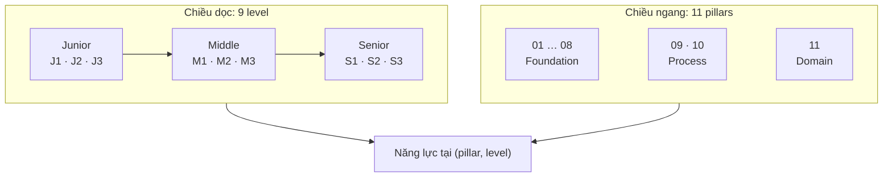

# Khái niệm & triết lý

## ITFS là gì

**ITFS (Intentional Thinking Full-Stack)** là khung năng lực chuẩn hoá cho Fullstack Engineer. Khung trả lời hai câu hỏi:

- **Ở mỗi level, kỹ sư cần làm được gì?** — kỳ vọng về tư duy, phạm vi ảnh hưởng và vai trò.
- **Học gì, theo thứ tự nào để đáp ứng level?** — lộ trình 9 giai đoạn cho từng pillar.

## Triết lý: Intentional Thinking

Mọi dòng code và mọi quyết định kỹ thuật phải xuất phát từ **tư duy có chủ đích**, không phải thói quen thụ động hay copy-paste. Trong thời đại AI, điều này càng quan trọng: AI tăng tốc độ viết code, còn kỹ sư chịu trách nhiệm hoàn toàn về việc **xây đúng thứ cần xây** và **xây cho đúng**.

## 3 trụ cột phát triển

| Trụ cột                                        | Mô tả                                                                                                                   | Tiến trình                           |
| ---------------------------------------------- | ----------------------------------------------------------------------------------------------------------------------- | ------------------------------------ |
| **Technical Mastery** Chuyên môn kỹ thuật | 11 Hard Skill Pillars: lập trình, kiến trúc, dữ liệu, API, UI, test, hiệu năng, bảo mật, quy trình, tài liệu, nghiệp vụ | 9 giai đoạn học cho mỗi pillar       |
| **AI Fluency** Năng lực điều phối AI      | Dùng AI như công cụ khuếch đại năng lực, không thay thế tư duy và trách nhiệm của kỹ sư                                 | Consumer → Orchestrator → Strategist |
| **Requirement Thinking** Tư duy yêu cầu   | Hiểu đúng vấn đề trước khi giải, đánh giá tác động và đánh đổi trước khi quyết định                                     | Clarify → Impact → Trade-off         |

## Hai chiều của khung

ITFS tổ chức năng lực theo hai chiều:

- **Chiều ngang — 11 pillars:** các nhóm năng lực kỹ thuật và nghiệp vụ. Xem [11 Hard Skill Pillars](../02-pillars/README.mdx).
- **Chiều dọc — 9 level:** J1 → J2 → J3 → M1 → M2 → M3 → S1 → S2 → S3. Xem [Level & Bloom's Taxonomy](./02-levels.mdx).

Giao của một pillar và một level là **năng lực cụ thể** cần đạt, gồm: kỹ năng trọng tâm, chủ đề cốt lõi, hành vi kỳ vọng và cách dùng AI.

## Ma trận năng lực chung

<Table variant="matrix" caption="General Competency Matrix">

| Level                     | Bloom's Anchor     | Scope                | Role                           | AI Fluency                                                                                  | Requirement Thinking                                                                             |
| ------------------------- | ------------------ | -------------------- | ------------------------------ | ------------------------------------------------------------------------------------------- | ------------------------------------------------------------------------------------------------ |
| <LevelBadge level="J1" /> | Remember           | Task đơn lẻ          | Member                         | Dùng AI tools cơ bản. Nhận biết AI có thể trả về thông tin sai hoặc vi phạm convention.     | Nhận biết khi requirement chưa rõ. Biết cần hỏi ai.                                              |
| <LevelBadge level="J2" /> | Understand         | Kết nối tasks        | Member                         | Hiểu hallucination. Đọc, giải thích và kiểm tra logic code do AI sinh ra.                   | Chủ động hỏi để làm rõ khi mơ hồ. Dùng AI gợi ý câu hỏi clarify.                                 |
| <LevelBadge level="J3" /> | Understand → Apply | Bản thân → nhóm      | Member                         | Viết prompt kèm Context Packet. Validate output của AI có hệ thống trước khi commit.        | Clarify scope trước khi code. Kiểm tra tác động cơ bản lên module liên quan.                     |
| <LevelBadge level="M1" /> | Apply              | Own nhóm             | Member                         | Thiết lập workflow Req → Design → Code → Test. Phân định task cho AI và cho con người.      | Không code khi còn mơ hồ. Phân tích tác động trước khi code. Trình bày ≥ 2 phương án.            |
| <LevelBadge level="M2" /> | Apply → Analyze    | Cross-team           | Member / Line Leader           | Prompt engineering phức tạp. Đánh giá pattern trong output AI. Coach team kỷ luật dùng AI.  | Coach team cách clarify. Phân tích phụ thuộc cross-module và side effect.                        |
| <LevelBadge level="M3" /> | Analyze            | Line / Project       | Line Leader                    | Phân tích giới hạn của AI với domain. Thiết lập AI guidelines cho dự án.                    | Nâng chất lượng requirement toàn project. Phân tích trade-off cho stakeholders dựa trên dữ liệu. |
| <LevelBadge level="S1" /> | Analyze → Evaluate | Multi Line / Project | Line Leader / Line Manager     | Đánh giá tác động của AI-augmented development trên nhiều dự án. Thúc đẩy văn hóa dùng AI.  | Đánh giá requirement, impact và trade-off trên nhiều dự án song song.                            |
| <LevelBadge level="S2" /> | Evaluate           | Department           | Line Manager                   | Thiết lập AI guidelines & standards cấp department. AI tăng năng suất mà không tạo lỗ hổng. | Thiết lập chuẩn quản lý yêu cầu. Tối ưu cân bằng chi phí – thời gian – chất lượng.               |
| <LevelBadge level="S3" /> | Evaluate → Create  | Organization         | Line Manager / General Manager | Kiến tạo văn hóa và SDLC framework AI-augmented cho toàn tổ chức.                           | Kiến tạo văn hóa requirement engineering và phương pháp ra quyết định cho tổ chức.               |

</Table>

Chi tiết từng trục: [Level & Bloom's Taxonomy](./02-levels.mdx) · [AI Fluency](./03-ai-fluency.mdx) · [Requirement Thinking](./04-requirement-thinking.mdx).
