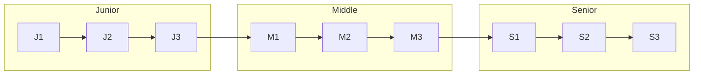

# Level & Bloom's Taxonomy

ITFS chia lộ trình thành **3 band, 9 level**. Mỗi level gắn với một mức tư duy trong **thang Bloom (Bloom's Taxonomy)**, một phạm vi ảnh hưởng (**Scope**) và một vai trò trong tổ chức (**Org Role**).

## Bảng level

<Table caption="9 level ITFS">

| Level                     | Bloom's Anchor                                   | Scope                | Org Role                       |
| ------------------------- | ------------------------------------------------ | -------------------- | ------------------------------ |
| <LevelBadge level="J1" /> | **Remember** Ghi nhớ                        | Task đơn lẻ          | Member                         |
| <LevelBadge level="J2" /> | **Understand** Hiểu, giải thích             | Kết nối tasks        | Member                         |
| <LevelBadge level="J3" /> | **Understand → Apply** Bắt đầu áp dụng      | Bản thân → nhóm      | Member                         |
| <LevelBadge level="M1" /> | **Apply** Áp dụng thành thạo                | Own nhóm             | Member                         |
| <LevelBadge level="M2" /> | **Apply → Analyze** Áp dụng + phân tích     | Cross-team           | Member / Line Leader           |
| <LevelBadge level="M3" /> | **Analyze** Phân tích hệ thống              | Line / Project       | Line Leader                    |
| <LevelBadge level="S1" /> | **Analyze → Evaluate** Phân tích + đánh giá | Multi Line / Project | Line Leader / Line Manager     |
| <LevelBadge level="S2" /> | **Evaluate** Đánh giá, thiết lập chuẩn      | Department           | Line Manager                   |
| <LevelBadge level="S3" /> | **Evaluate → Create** Sáng tạo hệ thống mới | Organization         | Line Manager / General Manager |

</Table>

## Ý nghĩa từng level

### Junior — thực thi và hiểu

- **J1 · Remember:** Thực thi task đơn lẻ theo hướng dẫn. Viết code đúng syntax, tuân thủ convention, biết escalate khi bí.
- **J2 · Understand:** Hiểu code flow và mối liên kết giữa các task. Giải thích được _tại sao_ áp dụng một convention hay pattern.
- **J3 · Understand → Apply:** Tự implement feature với ít hướng dẫn. Bắt đầu mở rộng sang cross-stack (FE ↔ BE).

### Middle — làm chủ và phân tích

- **M1 · Apply:** Own module/feature end-to-end. Trình bày ≥ 2 giải pháp kèm ưu, nhược điểm trước khi chọn.
- **M2 · Apply → Analyze:** Phân tích ở phạm vi cross-team. Bắt đầu tách hai track (xem bên dưới).
- **M3 · Analyze:** Phân tích hệ thống ở phạm vi Line/Project. Định hình chuẩn mực hoặc là người quyết định kỹ thuật của dự án.

### Senior — đánh giá và kiến tạo

- **S1 · Analyze → Evaluate:** Đánh giá và phê duyệt giải pháp, tech stack cho nhiều dự án.
- **S2 · Evaluate:** Thiết lập chuẩn mực công nghệ, quy trình, bảo mật và chất lượng cấp department.
- **S3 · Evaluate → Create:** Sáng tạo hệ thống, framework mới. Kiến tạo tầm nhìn và văn hóa công nghệ cho toàn tổ chức.

## Dual-track từ M2

Từ **M2**, kỳ vọng của mỗi pillar tách thành hai hướng phát triển song song. Trong trang pillar, hai hướng này được ghi là **Management** và **Expert**.

| Track          | Trọng tâm                                                                                    | Ví dụ ở M2–M3                                                                             |
| -------------- | -------------------------------------------------------------------------------------------- | ----------------------------------------------------------------------------------------- |
| **Management** | Dẫn dắt con người và quy trình: review, coach, thiết lập chuẩn, ra quyết định cho team/dự án | Review kiến trúc, phòng ngừa over-engineering; định hình chuẩn cho Line/Project           |
| **Expert**     | Chiều sâu kỹ thuật: phân tích hệ thống, làm chủ nhiều stack, xử lý vấn đề khó                | Phân tích sâu hệ thống, master nhiều stack; go-to person cho quyết định kỹ thuật phức tạp |

:::tip[Đọc level như thế nào]
Level không phải danh sách kiến thức cần "học thuộc". Mỗi level mô tả **mức tư duy** (Bloom) và **phạm vi ảnh hưởng** (Scope). Cùng một chủ đề, ví dụ indexing, J2 cần _giải thích_ được, J3 cần _áp dụng_ đúng, còn M2 cần _phân tích_ được trade-off trên dữ liệu thật.
:::
