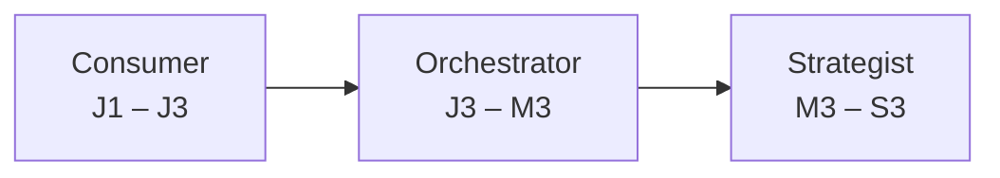

# AI Fluency

**AI Fluency** là năng lực dùng AI như một công cụ khuếch đại, trong khi kỹ sư vẫn giữ toàn bộ trách nhiệm về tính đúng đắn, an toàn và hiệu năng của sản phẩm.

| Giai đoạn        | Ý nghĩa                                                                         |
| ---------------- | ------------------------------------------------------------------------------- |
| **Consumer**     | Dùng AI để hỗ trợ công việc cá nhân, biết AI có thể sai và kiểm tra lại         |
| **Orchestrator** | Thiết kế workflow để AI và con người cùng làm việc, kiểm soát chất lượng output |
| **Strategist**   | Định hướng cách cả tổ chức áp dụng AI: guideline, chuẩn mực, văn hóa            |

## Hành vi theo level

<Table caption="AI Fluency theo level">

| Level                     | Giai đoạn                 | Hành vi kỳ vọng                                                                                             |
| ------------------------- | ------------------------- | ----------------------------------------------------------------------------------------------------------- |
| <LevelBadge level="J1" /> | Consumer                  | Dùng AI tools cơ bản. Nhận biết AI có thể trả về thông tin sai hoặc vi phạm convention.                     |
| <LevelBadge level="J2" /> | Consumer                  | Hiểu hiện tượng hallucination. Đọc, giải thích và kiểm tra logic code do AI sinh ra.                        |
| <LevelBadge level="J3" /> | Consumer → Orchestrator   | Viết prompt có context (Context Packet). Validate output của AI có hệ thống trước khi commit.               |
| <LevelBadge level="M1" /> | Orchestrator              | Thiết lập workflow Req → Design → Code → Test. Phân định rõ task nào giao AI, task nào cần con người.       |
| <LevelBadge level="M2" /> | Orchestrator              | Prompt engineering phức tạp. Phân tích pattern trong output của AI. Coach team kỷ luật dùng AI.             |
| <LevelBadge level="M3" /> | Orchestrator → Strategist | Phân tích giới hạn của AI với domain nghiệp vụ. Thiết lập AI guidelines cho dự án.                          |
| <LevelBadge level="S1" /> | Strategist                | Đánh giá tác động của AI-augmented development trên nhiều dự án. Thúc đẩy áp dụng Manifesto.                |
| <LevelBadge level="S2" /> | Strategist                | Thiết lập AI guidelines & best practices cấp department. Đảm bảo AI khuếch đại năng lực, không tạo điểm mù. |
| <LevelBadge level="S3" /> | Strategist                | Kiến tạo AI-augmented SDLC framework và văn hóa dùng AI cho toàn tổ chức.                                   |

</Table>

## Nguyên tắc xuyên suốt

- **Con người chịu trách nhiệm 100%.** Code do AI sinh ra qua cùng quy trình review, test, bảo mật như code do người viết — không có "fast-track".
- **Không prompt khi yêu cầu còn mơ hồ.** Chất lượng output phụ thuộc chất lượng context. Xem [AI Quality Gates & Context Packet](../03-execution/02-ai-quality-gates.md).
- **AI mạnh ở implementation, yếu ở design và business alignment.** Quyết định kiến trúc, contract và trade-off thuộc về kỹ sư.

Mỗi pillar có cột **AI** riêng mô tả cách áp dụng các nguyên tắc này vào lĩnh vực cụ thể. Xem [11 Hard Skill Pillars](../02-pillars/README.mdx).
