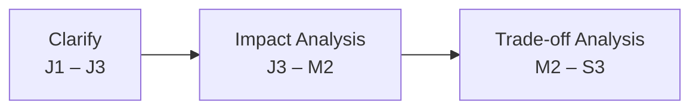

# Requirement Thinking

**Requirement Thinking** là thói quen **hiểu đúng vấn đề trước khi giải**: làm rõ yêu cầu, đánh giá tác động của thay đổi và cân nhắc đánh đổi trước khi ra quyết định. Đây là yếu tố khác biệt chính giữa kỹ sư "nhận spec rồi code" và kỹ sư tạo ra giá trị kinh doanh.

| Giai đoạn              | Câu hỏi trọng tâm                                                                                   |
| ---------------------- | --------------------------------------------------------------------------------------------------- |
| **Clarify**            | Yêu cầu đã rõ chưa? Scope gồm gì, không gồm gì? Cần hỏi ai?                                         |
| **Impact Analysis**    | Thay đổi này ảnh hưởng module, dữ liệu, người dùng nào? Có side effect gì?                          |
| **Trade-off Analysis** | Có những phương án nào? Mỗi phương án tốn bao nhiêu chi phí, thời gian, đánh đổi chất lượng ra sao? |

## Hành vi theo level

<Table caption="Requirement Thinking theo level">

| Level                     | Trọng tâm                | Hành vi kỳ vọng                                                                                                     |
| ------------------------- | ------------------------ | ------------------------------------------------------------------------------------------------------------------- |
| <LevelBadge level="J1" /> | Clarify cơ bản           | Nhận biết khi requirement chưa rõ. Biết cần hỏi ai.                                                                 |
| <LevelBadge level="J2" /> | Chủ động Clarify         | Chủ động đặt câu hỏi khi mơ hồ, không ngồi chờ. Dùng AI gợi ý danh sách câu hỏi clarify.                            |
| <LevelBadge level="J3" /> | Clarify + Impact cơ bản  | Clarify scope (in/out-of-scope) trước khi code. Viết Context Packet. Kiểm tra tác động cơ bản lên module liên quan. |
| <LevelBadge level="M1" /> | Impact Analysis          | Không code khi còn mơ hồ. Phân tích tác động lên module trước khi code. Trình bày ≥ 2 phương án kèm ưu, nhược điểm. |
| <LevelBadge level="M2" /> | Impact + Trade-off       | Coach team cách clarify. Phân tích phụ thuộc cross-module và side effect tiềm ẩn.                                   |
| <LevelBadge level="M3" /> | Trade-off Analysis       | Thúc đẩy chất lượng requirement toàn project. Phân tích trade-off cho stakeholders dựa trên dữ liệu.                |
| <LevelBadge level="S1" /> | Evaluate cả 3 giai đoạn  | Đánh giá cách làm requirement, impact và trade-off trên nhiều dự án.                                                |
| <LevelBadge level="S2" /> | Standards cả 3 giai đoạn | Thiết lập chuẩn quản lý yêu cầu. Tối ưu cân bằng chi phí – thời gian – chất lượng.                                  |
| <LevelBadge level="S3" /> | Kiến tạo framework       | Kiến tạo văn hóa requirement engineering và phương pháp ra quyết định cho tổ chức.                                  |

</Table>

## Liên hệ với các pillar

Requirement Thinking thể hiện rõ nhất ở ba pillar:

- [02 · Software Design & Architecture](../02-pillars/02-software-design-architecture.mdx) — Impact Analysis và Trade-off Analysis là năng lực lõi.
- [09 · Engineering Process](../02-pillars/09-engineering-process.mdx) — "nghĩ trước khi làm": DoR, DoD, shift-left.
- [11 · Business & Domain Understanding](../02-pillars/11-business-domain-understanding.mdx) — chủ động Clarify là yếu tố khác biệt chính.
