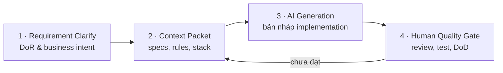

# AI Quality Gates & Context Packet

Để làm chủ AI trong vòng đời phát triển phần mềm (SDLC), ITFS quy định quy trình **4 bước bắt buộc**. AI chỉ tham gia ở bước 3; ba bước còn lại thuộc trách nhiệm của kỹ sư.

## Bước 1 — Requirement Clarify (DoR)

Làm rõ bối cảnh, mục tiêu người dùng và ranh giới scope.

:::warning
Không prompt AI khi yêu cầu còn mơ hồ. AI sẽ "lấp chỗ trống" bằng giả định, và giả định sai trông rất thuyết phục.
:::

## Bước 2 — Context Packet

Chuẩn bị bộ ngữ cảnh đầu vào cho AI. Một Context Packet tối thiểu gồm:

| Thành phần                | Nội dung                                                              |
| ------------------------- | --------------------------------------------------------------------- |
| **Business Context**      | Feature giải quyết vấn đề gì, cho ai; domain rules liên quan          |
| **Technical Constraints** | Stack, phiên bản, giới hạn hiệu năng/bảo mật, những gì không được đổi |
| **Coding Conventions**    | Quy ước đặt tên, cấu trúc thư mục, pattern đang dùng trong project    |
| **Existing Interfaces**   | API contract, schema, type/interface sẵn có mà code mới phải khớp     |

## Bước 3 — AI Generation

AI đóng vai **trợ lý tạo bản nháp**: viết boilerplate hoặc implementation dựa trên Context Packet. Output ở bước này là **draft**, chưa phải code để merge.

## Bước 4 — Human Quality Gate (DoD)

Kỹ sư trực tiếp rà soát trước khi merge PR:

- [ ] Code review: đúng intent, đúng kiến trúc, đúng conventions
- [ ] Security scan: secrets, validation, auth, IDOR, rate limiting
- [ ] Test: edge cases, error paths, boundary — không chỉ happy path
- [ ] Profiling khi có thay đổi ảnh hưởng hiệu năng
- [ ] Tài liệu, evidence đầy đủ theo DoD

Chưa đạt thì quay lại bước 2: bổ sung context, không "vá" output bằng prompt mơ hồ.

## Mức kỳ vọng theo level

| Level   | Kỳ vọng với quy trình này                                                           |
| ------- | ----------------------------------------------------------------------------------- |
| J1 – J2 | Thực hiện bước 4 cho phần việc của mình; nhận biết khi AI sai convention, sai logic |
| J3 – M1 | Tự chuẩn bị Context Packet; làm chủ cả 4 bước cho feature mình own                  |
| M2 – M3 | Coach team, thiết lập review gates và guideline dùng AI cho dự án                   |
| S1 – S3 | Chuẩn hóa quy trình ở cấp department/tổ chức; đánh giá tác động trên nhiều dự án    |
