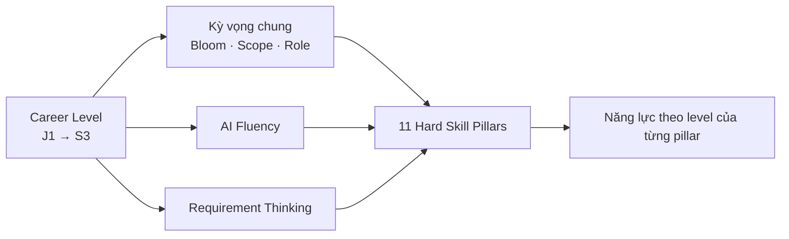

# ITFS Skills

**ITFS (Intentional Thinking Full-Stack)** là khung đánh giá năng lực và lộ trình phát triển chuyên môn cho Fullstack Engineer. Trọng tâm của ITFS là chuyển từ "viết code theo chỉ dẫn" sang **chủ động tư duy**: hiểu vấn đề, làm chủ công nghệ và điều phối AI để tạo ra giá trị kinh doanh bền vững.

## Khung năng lực nhìn nhanh

| Chiều                    | Nội dung                                                                  |
| ------------------------ | ------------------------------------------------------------------------- |
| **Level**                | 9 level chia 3 band: Junior (J1–J3), Middle (M1–M3), Senior (S1–S3)       |
| **Technical Mastery**    | 11 Hard Skill Pillars, mỗi pillar có lộ trình học 9 giai đoạn             |
| **AI Fluency**           | Consumer → Orchestrator → Strategist                                      |
| **Requirement Thinking** | Clarify → Impact Analysis → Trade-off Analysis                            |
| **Kỳ vọng theo level**   | Bloom's Anchor, Scope, Org Role — từ task đơn lẻ đến phạm vi toàn tổ chức |

## Nội dung section

<DocCardList />

## Nguồn

Nội dung được biên soạn lại từ **ITFS foundation Hardskill Version 1.0.0** và **TechTus Hard Skills Matrix — Fullstack Engineer**.
